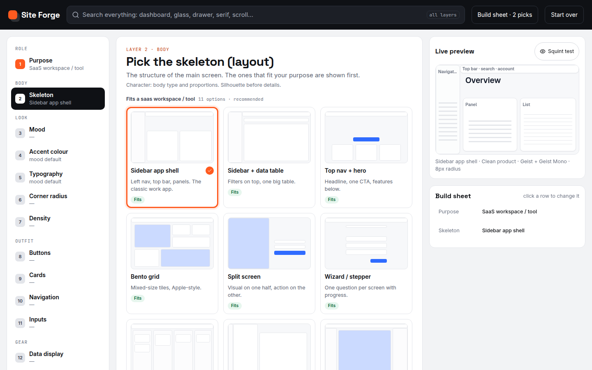

# Site Forge

**Live:** https://site-forge-dun.vercel.app

Site Forge helps you decide what a website should look like before you ask an AI to build it. You work in layers, the way a character designer goes from role to body type to art style to outfit to signature move: pick the site's purpose, then a layout skeleton, then the look (mood, accent, type, radius, density), the components, and one signature effect. Options that fit your purpose rise to the top, every option has a live demo painted in your current picks, and a live preview redraws the whole page as you go. At the end it exports three files for Claude Code: a `DESIGN.md`, a ready-to-paste prompt, and a `tokens.css`.



## Run it

Needs Node.js 20.9 or newer.

```bash
npm install
npm run dev      # http://localhost:3000
```

Other commands:

```bash
npm test         # unit tests (Vitest)
npm run lint     # ESLint
npm run build    # production build, also type-checks
npm start        # serve the production build
```

It runs entirely in the browser: no backend, no accounts, no API calls. Your picks are saved in `localStorage`; **Start over** clears them.
